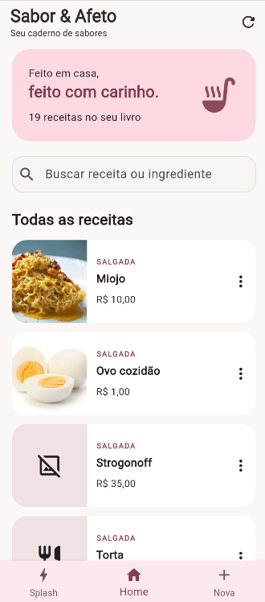
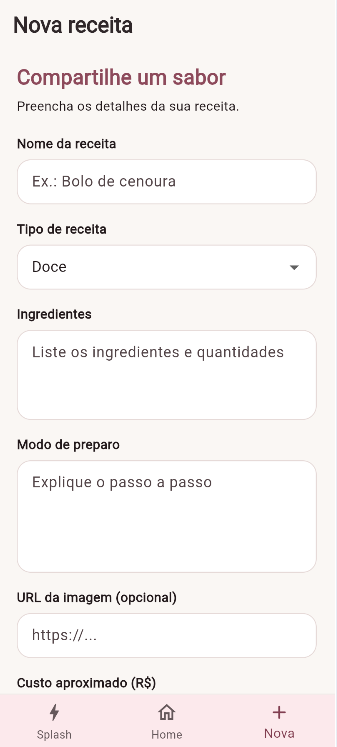

# Sabor & Afeto — Livro de Receitas

Aplicativo mobile desenvolvido em Flutter para consultar, cadastrar, editar e excluir receitas por meio de uma API REST.

## Funcionalidades

- Splash Screen com animação.
- Tela inicial com listagem de receitas.
- Cadastro de novas receitas.
- Edição de receitas existentes.
- Exclusão de receitas.
- Navegação inferior com as opções Splash, Início e Nova.
- Tema claro e escuro.
- Integração com API REST para gerenciamento das receitas.

## Tecnologias utilizadas

- Flutter
- Dart
- API REST
- HTTP
- Material Design

## API utilizada

O aplicativo utiliza a API de receitas disponível em:

https://receitasapi-b-2025.vercel.app

## Capturas de tela

### Splash Screen


### Tela inicial



### Cadastro de receita



> As imagens devem estar salvas na pasta `assets` com os nomes utilizados acima.

## Como executar o projeto

### Pré-requisitos

- Flutter instalado.
- Dart instalado.
- Visual Studio Code ou outra IDE compatível.
- Conexão com a internet para acessar a API.

### Instalação

1. Clone o repositório:

   ```bash
   git clone URL_DO_SEU_REPOSITORIO